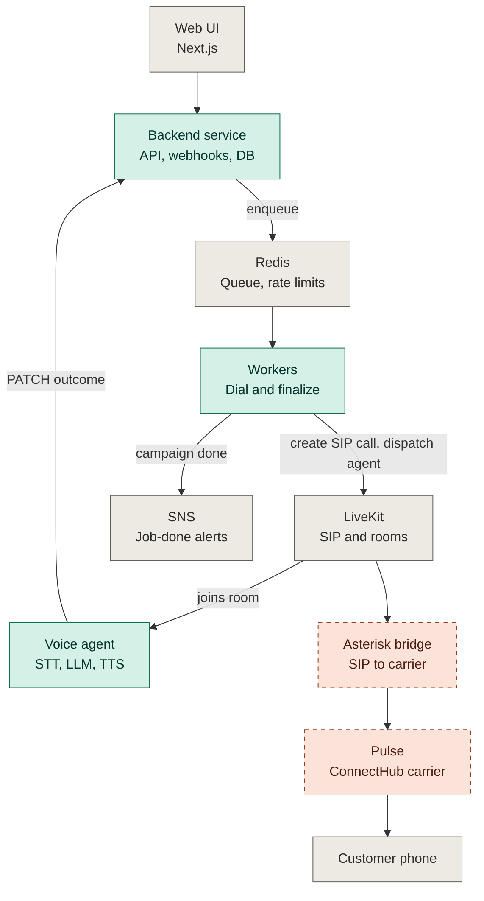

# Simplified Voice Agent Architecture

A reduced version of the original call-handling platform. It keeps the chain

**UI -> single backend service -> Redis, workers, SNS, LiveKit -> bridge -> Pulse**

and adds the voice agent, since something has to talk to the customer.

## Diagram

**Legend:** teal = your code, gray = managed service or infrastructure, coral dashed = external carrier path.

## Components

| Component          | Role                                                                                                                                       |
| ------------------ | ------------------------------------------------------------------------------------------------------------------------------------------ |
| Web UI             | Next.js front end. Sends all requests to the one backend service.                                                                          |
| Backend service    | Single API service. Owns the database, validates requests, writes call records, enqueues jobs, receives agent outcomes and fires webhooks. |
| Redis              | Job queue (streams), rate limits (CPS), and channel (concurrency) counters.                                                                |
| Workers            | Pull jobs from Redis, enforce limits, ask LiveKit to dial, dispatch the agent on answer, and finalize campaigns.                           |
| LiveKit            | SIP gateway and rooms. Places the call and hosts the agent session.                                                                        |
| Voice agent        | Joins the LiveKit room, talks to the customer (STT, LLM, TTS), and reports the outcome to the backend.                                     |
| SNS                | Notification when a campaign finishes.                                                                                                     |
| Asterisk bridge    | SIP hop from LiveKit to the carrier path. External.                                                                                        |
| Pulse (ConnectHub) | Carrier path to the phone network. External.                                                                                               |
| Customer phone     | The called party.                                                                                                                          |

## How a call flows

1. The UI sends a request (single call or campaign) to the one backend service.
2. The backend writes a `queued` record to its database and pushes the job onto a Redis stream.
3. Workers pull jobs from Redis. They check rate limits and channel counters, then ask LiveKit to dial.
4. LiveKit places the SIP call through the Asterisk bridge to Pulse, which reaches the customer's phone.
5. When the call is answered, the worker dispatches the voice agent into the LiveKit room.
6. The agent talks to the customer, then reports the outcome to the backend, which fires webhooks.
7. When a campaign finishes, the workers publish to SNS.

## What this removes from the original design

- Single calls and campaigns share one queue. A separate priority stream is optional later.
- The inbound sync flow, failure-reason webhooks and DLQ replay loops can wait until you need them.

## Where to keep it simple

- Redis does the same three jobs as before (queue, rate limits, channel counters), because those are what keep the system from overloading your carrier.
- SNS is optional. A job-complete status in the database plus a webhook to your own UI covers the same need until another system has to react.
- Run the backend and workers as one codebase in two process types (API and worker). You can start with a single container each.
